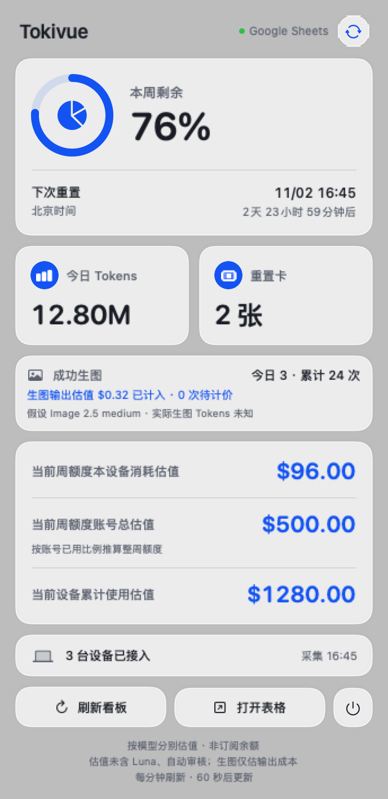
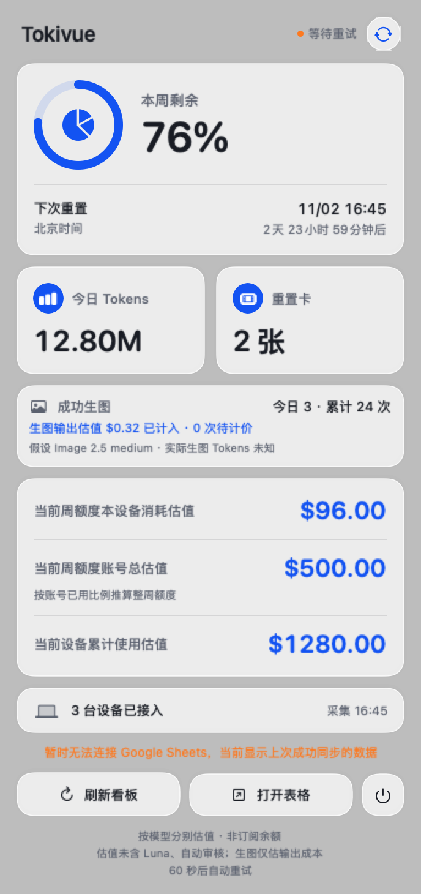
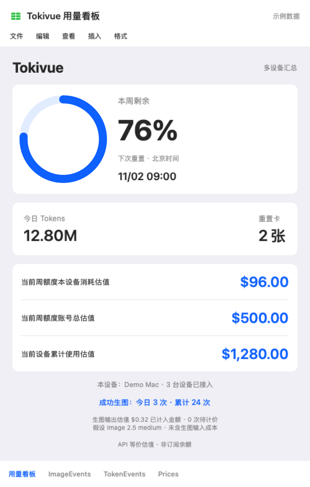

# Tokivue — Codex 多设备用量与额度看板

Tokivue 将本地用量采集器、Google Sheets 汇总接收端和 macOS 原生菜单栏看板连接起来，让每一份 AI 用量看得见。

项目仓库：[loganzzzzz/tokivue](https://github.com/loganzzzzz/tokivue)。

## 界面预览

以下图片均使用虚构示例数据。macOS 卡片由实际界面组件渲染；Google Sheets 图片为布局示意，不含真实账号、表格链接或用量记录。

### macOS 状态栏弹窗

浅色控制中心风格：周剩余额度、今日 Tokens、生图统计和三项美元估值集中展示；右上角可手动重连。

<table>
  <tr><th>正常同步</th><th>离线重试</th></tr>
  <tr>
    <td valign="top"></td>
    <td valign="top"></td>
  </tr>
</table>

左图为正常同步，右图为暂时离线：保留上次结果，并显示重试提示。点击弹窗外部可关闭，窗口也会在 30 秒后自动收起。

### Google Sheets 用量看板

多设备共用一个汇总表；三项估值顺序与菜单栏一致。下方数据表保存去重后的用量事件与额度快照。



## 功能

- macOS / Windows 定时读取本地 Codex 日志及只读账号额度接口，不启动模型任务。
- 北京时间周一至周五 09:00–18:00 每 10 分钟采集，其余时间每小时；不自动识别法定节假日。睡眠期间不运行。
- 多设备事件去重、失败保留队列、归档会话与可验证的压缩用量采集。
- 周剩余额度、今日 Tokens、本设备周估值、账号周额度总估值、本设备累计估值。
- 成功生图计数，按 GPT Image 2.5 medium 和实际尺寸估算输出成本；不包含图片输入成本，不把估算图片 Tokens 混入实际 Tokens。
- macOS 浅色控制中心式弹窗，60 秒读取 Sheets 汇总、手动重连、30 秒自动收起。

Windows 包提供后台采集，不包含 macOS 菜单栏界面。

## 首次配置

需要 Python 3.9+、已登录的原生 Codex CLI 和 Google 账号。macOS 应用还需要 macOS 13+、Xcode Command Line Tools。

1. 在项目根目录运行 `python3 collector/monitor.py init`。配置保存在 `~/.codex-usage-monitor/config.json`（Windows 对应用户目录）。
2. 在配置中设置 `codex_binary` 为可执行的原生 CLI 路径。Windows 不要填写桌面应用 `Codex.exe` 或目录路径。
3. 运行 `python3 collector/monitor.py run --force`，验证账号并生成 `account_key`。此时未配置上传是正常状态。
4. 创建一个专用空白 Google Sheet，以及独立 Apps Script 项目。复制 `collector/google-apps-script/Code.gs` 和 `appsscript.json`。
5. 在脚本属性中设置 `SPREADSHEET_ID`、`ACCOUNT_KEY`（本机配置中的账号指纹）、`UPLOAD_SECRET`（随机且至少 32 字符；可用 Python `secrets.token_urlsafe(32)` 生成）。这些值只保存于私有配置和脚本属性。
6. 运行 `setup()` 初始化表结构，然后运行 `enableImageGenerationStats()` 创建图片事件表。`setup()` 会重新创建看板布局，仅用于专用表首次部署。
7. 在 `Prices` 表 A:G 的标题下填入各模型价格，列顺序为模型、输入、缓存读取、输出、缓存写入、来源 URL、核实日期。可参考 `collector/pricing-reference.json` 中已标注日期的历史价格；正式使用前核对官方价格。缺价模型会阻止完整金额显示。不要运行针对旧私人表布局的价格迁移函数。详细操作见[估值与自定义模型价格](#估值与自定义模型价格)。
8. 将 Apps Script 部署为 Web 应用，执行身份为自己，访问者为任何人。表格本身保持私有。接口以请求体中的共享密钥与账号指纹鉴权；持有密钥者可以读取汇总，请勿分享密钥。
9. 将部署地址和密钥填入本机配置的 `upload_url`、`upload_secret`，将表格 HTTPS 链接填入 `sheet_url`（macOS“打开表格”按钮使用）。再次运行采集确认上传。
10. 要启用浅色三项估值看板：首次成功上传后，将 `QuotaSnapshots` 中目标设备的 `device_id` 填入“用量看板”K23，运行 `syncLightOverview()`，再运行 `enableImageGenerationStats()`。共享表格固定显示该设备；各 Mac 菜单栏按各自设备显示。

Luna 与自动审核保留 Tokens，但默认排除美元估值。价格为 Standard 短上下文参考值，不含 Fast、区域附加费等。账号总估值为本窗口采集金额除以官方已用比例；已用 0%、数据过期或缺价时不估算。这不是订阅余额。

## 估值与自定义模型价格

### 三项金额分别代表什么

金额单位为美元（USD），表示已采集用量的 **API 等价估值**，不是订阅账户余额、实际账单或可兑现额度。

| 看板项目 | 计算范围 |
| --- | --- |
| 当前周额度本设备消耗估值 | 当前设备在官方当前周窗口内上传的、可计价的去重用量 |
| 当前周额度账号总估值 | 所有已接入设备在当前周窗口内的采集估值 ÷ 官方已用额度比例，推算整周 100% 额度的参考价值 |
| 当前设备累计使用估值 | 当前设备从采集起始日期以来的可计价用量，跨周保留 |

例如，所有设备本窗口共采集到 **$120**，官方显示已用 **24%**，则账号整周估值为 `$120 ÷ 0.24 = $500`。这不是剩余额度的价值；本设备的周消耗可以只有 $96，不要求与所有设备汇总相等。

“本周”按官方重置时间减去窗口时长划定，不固定按自然周。复制日志归首次上传设备，避免跨设备重复计价。未接入设备、云端任务、缺失日志、生图输入成本以及官方百分比的粒度都会影响推算；提前重置也可能影响窗口边界。官方额度比例包含的消耗不一定与本工具的可估价范围相同，因此账号总估值仅供参考。

### 单条 Token 用量如何计价

```text
非缓存输入 = input_tokens − cached_input_tokens − cache_write_input_tokens

估值（USD） = (
    非缓存输入 × 输入单价
  + cached_input_tokens × 缓存读取单价
  + cache_write_input_tokens × 缓存写入单价
  + output_tokens × 输出单价
) ÷ 1,000,000
```

推理 Tokens 已包含在输出中，不额外加一次。若输入总量小于缓存读取与写入之和，该记录的缓存归属不可靠，会按不可计价处理。生图输出估值另行计算，并加入相应设备、周窗口及累计金额。

### 价格配置在哪里

**运行时以 Google Sheets 的 `Prices` 工作表 A:G 列为准。** 所有设备共用这套价格；通常只需改表格，无须重装采集器或重新部署接收端。

| 列 | 表头 | 填写内容 |
| --- | --- | --- |
| A | `model` | 完整模型名，与 `TokenEvents` 的 F 列完全一致 |
| B | `input_usd_per_million` | 非缓存输入价格，美元／百万 Tokens |
| C | `cached_input_usd_per_million` | 缓存读取价格，美元／百万 Tokens |
| D | `output_usd_per_million` | 输出价格，美元／百万 Tokens |
| E | `cache_write_usd_per_million` | 缓存写入价格，美元／百万 Tokens |
| F | `source_url` | 价格来源，供人工核对 |
| G | `verified_on` | 核实日期，供人工维护 |

注意列顺序为 **输入、缓存读取、输出、缓存写入**。B、C、D 必须是非负数值；有缓存写入用量时 E 也必须有效。不要在单元格中填入 `$2/M` 之类的文本；填数字 `2`，再按需要设置数字格式。空白表示未知，明确填 `0` 则按零成本处理，不能用零掩盖未知价格。

`collector/pricing-reference.json` 是带核实日期的参考记录，**修改该文件不会自动同步 Sheets**。本机 `config.json` 的 `prices_per_million` 字段也不参与当前 Sheets 看板计价。项目不自动抓取或更新官网价格；使用者需自行核对价格适用的模型、服务等级和上下文长度。

### 新增模型或修改单价

1. 打开自己的 Google Sheet，在 `TokenEvents!F:F` 查到实际采集的完整模型名。版本后缀、大小写和空格都要一致；接收端不会自动将未知模型归到 Astra 或 Sol。
2. 打开 `Prices`，保留第 1 行表头。修改现有模型所在行，或在 A:G 的下一空行新增模型；同一模型只保留一行，避免重复配置。
3. 查阅对应服务的价格来源，例如 [OpenAI API 定价页](https://developers.openai.com/api/docs/pricing)，将单价换算为美元／百万 Tokens 后填写 B:E，记录 F:G。不同币种、每千 Tokens 或每张图片价格不能直接混填。
4. 保存后，在 Mac 状态栏点“刷新看板”，或运行 `python3 collector/monitor.py run --force`；Windows 可双击 `02-check.cmd`。接收端会重新读取价格并更新汇总，正常情况下状态栏下一次刷新即可显示新金额。
5. 若仍无金额，检查模型名称、数值类型、缓存写入价、排除清单及最近上传状态。改价不改变原始 Tokens 或官方剩余百分比。

下面是一行**纯演示价格，不代表任何真实模型报价**，可用来理解填写顺序：

| A：model | B：输入 | C：缓存读取 | D：输出 | E：缓存写入 | F：来源 | G：核实日期 |
| --- | ---: | ---: | ---: | ---: | --- | --- |
| `demo-model` | 2 | 0.2 | 10 | 2.5 | 自定义示例 | 2026-10-30 |

若该模型一次用量是输入 100,000、缓存读取 40,000、缓存写入 10,000、输出 5,000 Tokens，则非缓存输入为 50,000，估值为 `(50,000×2 + 40,000×0.2 + 10,000×2.5 + 5,000×10) ÷ 1,000,000 = $0.183`。

**旧版公式价格表：** 如果 A2 使用 `SORT/UNIQUE` 自动列模型，B2:G2 使用 `ARRAYFORMULA/VLOOKUP`，这些单元格是公式输出区，不要直接覆盖。应修改右侧 J:P 的参数表；J 为模型名，K:N 依次为输入、缓存读取、输出、缓存写入，O:P 为来源和日期。新增参数行后，把 B2:G2 中的查找范围一并扩展，例如从 `$J$2:$P$5` 改为 `$J$2:$P$6`。最终 A:G 必须能返回新增模型的数值价格。仅使用 `setup()` 初始化的空白 `Prices` 表可直接填写 A:G。

**历史金额会重算：** 接收端每次用当前价格重新计算已采集记录。G 列日期只是注记，不是价格生效日期，也不会按历史价格分段结算。若需保留调价前的估值，请先导出报表；需要按调用日期匹配不同价格的账单核算，必须另行实现价格历史表及日期匹配逻辑。当前也未自动区分长上下文、Fast、Batch 或区域附加费。

### 排除模型与缺价提示

默认 `EXCLUDED_COST_MODELS` 位于 `collector/google-apps-script/Code.gs`，包含：

```javascript
new Set(['gpt-5.6-luna', 'gpt-6-luna', 'codex-auto-review'])
```

这些模型保留 Token 统计，但不参与美元估值，也不算缺价。只在 `Prices` 添加它们的单价不会取消排除。要调整范围，需要修改这份集合、同步相关界面文案，并在 Apps Script“管理部署”中将现有 Web 应用更新到新版本；把模型重新纳入估值时，还要补齐其价格。

| 现象 | 含义与处理 |
| --- | --- |
| 某项显示“暂无估值” | 该项涉及的记录缺价、价格格式无效、缓存归属异常，或缺少设备／周窗口信息；先核对 `Prices` 与最新快照 |
| 本周金额正常，设备累计金额未知 | 历史记录可能包含当前周没有使用的缺价模型；补齐历史模型价格 |
| 账号总估值显示“暂不可估” | 官方已用比例为 0%、本窗口金额为零或未知、快照超过 75 分钟未更新，或周窗口已失效等；不能除以零或用过期比例推算 |
| 金额有值，但显示若干张图片“待计价” | 已计入可估算的图片输出成本；缺尺寸或尺寸无效的图片暂不加金额，总额因此可能不完整 |
| 改价后仍显示旧金额 | 需要成功读取接收端新摘要；离线缓存不会立即变化，先检查连接及采集／上传状态 |

缺价按具体统计范围判断：其他设备或旧周的缺价，不一定阻止本设备当前周金额显示。`missing_prices` 统计的是不可计价的用量记录数，不是不同模型的数量。

### 生图估值如何自定义

图片费用**不从 `Prices` 表读取**。当前接收端的 `imageOutputEstimate_()` 按 **GPT Image 2.5、medium** 假设计价，使用图片尺寸估算输出 Tokens，并以代码中的每百万输出 Tokens 单价换算美元。该假设来自项目的历史配置，并不表示日志记录了真实模型或质量档位。

- 仅修改图片输出单价：同步修改 `imageOutputEstimate_()` 的 `tokens * 30 / 1000000` 中的单价，以及 `getDashboardData()` 中 `imageStats.output_usd_per_million` 的说明值，然后更新现有 Apps Script 部署。
- 修改模型或质量：需同时替换对应的尺寸／Token 估算规则，以及 `assumed_model`、`assumed_quality`、Sheet 和 Mac 界面中的假设说明；不能只把 `medium` 文案改成 `high`。
- 尺寸先向上对齐到 16 像素；缺失或不符合当前计算规则的尺寸标记待计价。按模型或质量调整规则后，应重新核对这些边界。
- 当前金额只含可估算的图片输出，不含提示词、参考图输入或流式预览成本；估算图片 Tokens 不并入实际 Token 总数。

相关实现：[接收端及计价函数](collector/google-apps-script/Code.gs)、[价格参考记录](collector/pricing-reference.json)、[Mac 估值显示条件](Sources/CodexQuotaCore/SheetsDashboard.swift)。

## macOS 安装

完成私有配置后：

```sh
python3 collector/install_macos.py
chmod +x scripts/*.sh
./scripts/build-app.sh
open "dist/Tokivue.app"
```

可用 `./scripts/install-chatgpt-autostart.sh` 安装到用户 Applications 并启用 ChatGPT 联动启动。
采集器卸载：`python3 collector/install_macos.py --uninstall`，保留配置及历史数据。

## Windows 安装

复制 `collector` 目录至 Windows，安装标准 Python 后双击 `01-install.cmd`，输入自己的接收端地址和密钥。也可先按上述步骤初始化配置。已有安装会保留设备身份和队列。

- `02-check.cmd`：手动采集、上传并检查。
- `03-uninstall.cmd`：取消当前用户计划任务，保留本地数据。
- 多设备必须独立生成 `device_id`，不要复制整个 config.json 或 usage.sqlite；只复制接收端地址、密钥、账号指纹和需要一致的采集起始日期。

## 验证

```sh
swift run CodexQuotaTests
swift build -c release
(cd collector && python3 -m unittest test_monitor test_windows)
(cd collector && node test_receiver.cjs)
```

Python 与接收端测试使用合成数据，不需要真实 Google 或 Codex 凭据。Windows 任务注册仍需在 Windows 实机验证。

## 数据边界

上传只包含模型、用量时间、Token 数、账号额度、设备标识，以及成功生图事件的尺寸；不上传对话、图片、项目文件或登录令牌。图片日志没有实际模型和质量信息，medium 仅为明确的估算假设。

官方周额度由最新账号快照决定，不把多设备百分比相加。菜单栏每 60 秒刷新的是服务器汇总；不代表采集器每分钟获取额度，因此会有最多一个采集周期的延迟。未接入设备、云端任务、删除的日志及缺少可解析事件的旧版生图可能不在统计内。

本仓库不包含私人部署地址、账号指纹、配置、数据库、实际用量截图或运行日志。部署和使用者自行保管本地 `~/.codex-usage-monitor` 目录。

## 从旧名称升级

应用已从 Codex Quota 更名为 Tokivue。运行安装脚本会将旧应用移入本地备份并更新启动路径。为兼容已有安装，内部 Bundle ID、采集任务标识、Swift target 和 `~/.codex-usage-monitor` 数据目录保留原名；不需要重新配对 Google Sheets，也不要清空数据库。
